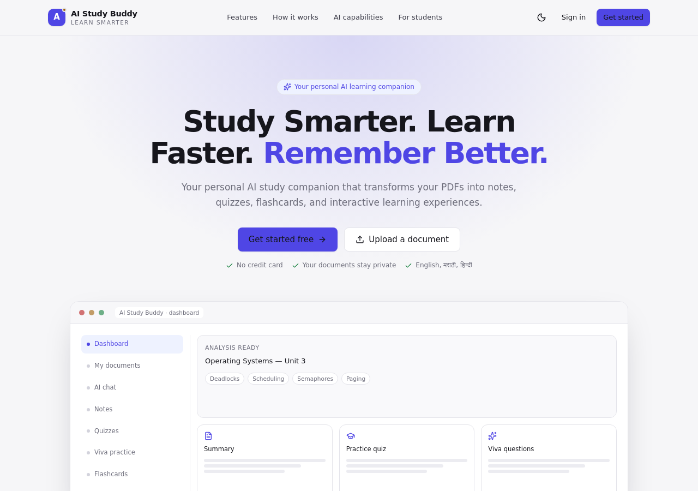

# AI Study Buddy

**Your personal AI learning companion.**

Upload your study material, and get an AI summary, study notes, a grounded chat assistant, quizzes,
oral-exam (viva) practice, flashcards, a study planner and progress analytics — in English, Marathi or
Hindi.

[](https://ai-study-buddy-live.vercel.app/)

## 🔗 Live Demo

**https://ai-study-buddy-live.vercel.app/**



*The live site as it renders at the URL above — captured by
[`.github/workflows/live-screenshot.yml`](.github/workflows/live-screenshot.yml), which refreshes this
image on demand and every Monday.*

Deployed on **Vercel**: the React SPA is served as static files and the Hono API runs as one Node
function, with a **Neon Postgres** database connected through Vercel Storage (`DATABASE_URL` is injected
by the integration). Create a free account, upload your first chapter, and get your summary, notes and a
practice quiz in minutes.

> AI features need `GEMINI_API_KEY` in the Vercel project's environment variables. Without it the app
> still works for uploads, extraction, saved content and all history; AI endpoints return a clear `503`.

---

## Runtime note (read first)

The request asked for **React + Vite + TypeScript + Tailwind** on the frontend, **Java/Spring Boot +
MongoDB Atlas** on the backend, and the **Gemini API** for AI. The frontend stack is exactly that.
The backend could not be built as Spring Boot **in this environment**: this cloud workspace has no JVM,
no Maven/Gradle, no MongoDB (and no Docker daemon to run one), and the hosting target (Cloudflare
Workers via Freebuff Sites) cannot run a Java process or a MongoDB driver.

Rather than ship Java that can never compile, run, or be deployed here, the same product was built as a
**real, running full-stack app** on the platform's runtime:

| Requested | Implemented here | Why |
|---|---|---|
| React, TypeScript, Vite, Tailwind, Lucide | Same (React 19, Vite 8, TS, Tailwind 4, Lucide) | Runs as requested |
| Java + Spring Boot REST API | Hono (TypeScript), same REST contract — Cloudflare Workers, or a Vercel Node function | No JVM in the workspace |
| MongoDB Atlas collections | SQL tables with the same entities, ownership indexes and JSON documents — D1 (SQLite) on Cloudflare, Postgres on Vercel | No MongoDB host |
| BCrypt | PBKDF2-SHA256, 100k iterations (WebCrypto) | No native bcrypt on Workers; runtime caps PBKDF2 at 100k |
| Apache PDFBox | `unpdf` (PDF.js) + `fflate` for DOCX | PDFBox is JVM-only |
| JWT (Spring Security) | Hand-rolled HS256 JWT verified in middleware | Equivalent behaviour, no dependency |

Every API path, request/response shape and feature in the brief is implemented. If you later need the
Java version, the backend is a thin, framework-free layer — the route handlers in `src/worker/routes/`
map 1:1 to Spring `@RestController` classes and `src/worker/db.ts` maps to Mongo collections.

---

## Features

- **Authentication** — register, login, logout, JWT sessions, PBKDF2 password hashing, profile,
  password change, single-use password reset tokens, protected routes, per-user data isolation.
- **Dashboard** — greeting, real counts (documents, quizzes, average score, study time, streak), 14-day
  activity chart, recent documents/quizzes, upcoming tasks, quick actions.
- **Documents** — drag-and-drop upload with real progress, PDF/TXT/DOCX validation, 15 MB limit, text
  extraction with page markers, scanned-PDF detection, AI summary, topics, concepts, definitions, key
  points, exam questions and chapter summaries.
- **AI chat** — document-grounded answers with page citations, modes (simple, detailed, beginner, exam,
  Marathi, English, example), saved chat history, clear/delete, dictation and read-aloud.
- **Notes** — 10 note styles, three languages, optional focus, regenerate, edit, save, copy and
  print-to-PDF export.
- **Quizzes** — 5/10/15/20 questions, easy/medium/hard, MCQ/true-false/mixed, one question at a time,
  navigation grid, optional countdown with auto-submit, server-side scoring, per-question explanations,
  weak-topic analysis and retry.
- **Viva practice** — AI examiner asks one question at a time, evaluates accuracy, understanding and
  completeness, shows what was right/missing, an ideal answer, and an overall report with revision list.
- **Flashcards** — generate from a document or chapter, flip animation, shuffle, mark easy/difficult,
  re-study difficult cards, saved decks.
- **Planner** — tasks with subjects, topics, target dates, completion tracking, and an AI plan that
  respects daily study time and the exam date.
- **Progress** — score trend, topic mastery, weak topics, 30-day activity, time by activity, quiz history.
- **Global assistant** — available on every app page, with general/document/subject context.
- **Design** — responsive sidebar shell, light/dark themes, empty states, loading states, toasts, motion
  that respects `prefers-reduced-motion`.

## Stack

- **Frontend**: React 19, TypeScript, Vite 8, Tailwind CSS 4, React Router 8, Lucide icons.
- **Backend**: Hono (`src/worker`), strict DTO validation, structured errors. Runs on Cloudflare Workers
  or as a single Vercel Node function (`server/vercel.ts` → `.vercel/output`).
- **Database**: Cloudflare D1 (SQLite) on the Workers build, **Postgres** on the Vercel build
  (`src/worker/pg.ts` implements the same prepared-statement surface the routes already use), per-user
  indexes and JSON columns for generated content.
- **AI**: Google Gemini `generateContent` REST API, default model `gemini-3.5-flash-lite` (configurable via `GEMINI_MODEL`; `gemini-3.8-flash` works but is often saturated on the free tier). Requests use `thinkingConfig.thinkingLevel = "low"` for latency and retry twice on 429/5xx.
- **Documents**: PDF.js via `unpdf`, DOCX via `fflate` + OOXML text extraction.

## Run it

```sh
bun install
cp .dev.vars.example .dev.vars   # then fill in JWT_SECRET and GEMINI_API_KEY
bun run dev                      # Vite + the Worker in workerd, http://localhost:5364
```

Other commands:

```sh
bun run typecheck   # TypeScript over frontend and backend
bun test            # unit tests (quiz scoring, extraction helpers)
bun run smoke       # end-to-end API checks against the running dev server
bun run build       # dist/client (assets) + dist/<worker>/index.js (Worker)
```

The database schema is created automatically on the first API request (`src/worker/db.ts`), so no
migration step is needed for a fresh local database. Local D1 state lives in `.wrangler/state`.

### Getting a Gemini API key

1. Open <https://aistudio.google.com/apikey> and sign in with a Google account.
2. **Create API key** (a free tier is available), copy it.
3. Put it in `.dev.vars` as `GEMINI_API_KEY=...` — never in frontend code or a committed file.
4. Restart the dev server.

If the key is missing, the app still works for uploads, extraction, saved content and all history; AI
endpoints return a clear `503` message and the UI shows a configuration banner. **No fake AI responses
are generated.** Use `GET /api/ai/status` to check configuration.

### Environment variables

| Variable | Required | Purpose |
|---|---|---|
| `JWT_SECRET` | yes | HS256 signing key (32+ random bytes) |
| `DATABASE_URL` | on Vercel | Postgres connection string (injected by the Vercel/Neon storage integration) |
| `GEMINI_API_KEY` | for AI | Server-side Gemini key |
| `GEMINI_MODEL` | no | Defaults to `gemini-3.5-flash-lite` (e.g. `gemini-3.8-flash`) |
| `FRONTEND_URL` | no | Comma-separated CORS origins; localhost always allowed |
| `AI_DAILY_LIMIT` | no | AI requests per user per day (default 300) |

## API

All authenticated routes need `Authorization: Bearer <jwt>` and only ever touch the caller's rows.

| Method | Path | Description |
|---|---|---|
| POST | `/api/auth/register` | Create account → token + user |
| POST | `/api/auth/login` | Sign in (throttled after 8 failures) |
| GET | `/api/auth/me` | Current user |
| PUT | `/api/auth/profile` | Name + preferred language |
| POST | `/api/auth/change-password` | Requires current password |
| POST | `/api/auth/forgot-password` | Creates a one-time reset token |
| POST | `/api/auth/reset-password` | Consume token, set new password |
| POST | `/api/documents/upload` | Multipart upload + extraction + analysis |
| GET | `/api/documents` · `/api/documents/{id}` | List · detail with analysis and preview |
| POST | `/api/documents/{id}/analyze` | Re-run analysis |
| DELETE | `/api/documents/{id}` | Delete document and derived content |
| POST | `/api/ai/chat` | Grounded Q&A, persists the chat |
| POST | `/api/ai/summarize` | Summary/topics/definitions/exam questions |
| POST | `/api/ai/generate-notes` | Notes in a chosen style and language |
| POST | `/api/ai/generate-quiz` | Creates a quiz, hides answers until submit |
| POST | `/api/ai/generate-flashcards` | Flashcard deck (saved via `/api/flashcards`) |
| POST | `/api/ai/explain` | Global assistant (general/document/subject) |
| POST | `/api/ai/generate-plan` | AI study plan → planner tasks |
| GET/POST/DELETE | `/api/chats` · `/api/chats/{id}` · `/api/chats/{id}/messages` | Chat CRUD |
| GET | `/api/quizzes` · `/api/quizzes/{id}` | Quiz list · detail |
| POST | `/api/quizzes/{id}/submit` | Server-side grading + result |
| DELETE | `/api/quizzes/{id}` | Delete attempt |
| GET/POST/PUT/DELETE | `/api/notes` · `/api/notes/{id}` | Notes CRUD |
| GET/POST/PUT/DELETE | `/api/tasks` · `/api/tasks/{id}` | Planner CRUD |
| GET | `/api/flashcards` · `/api/flashcards/{id}` | Decks (PUT updates card confidence) |
| POST | `/api/viva/start` · `/api/viva/{id}/answer` · `/api/viva/{id}/finish` | Oral exam flow |
| GET | `/api/analytics/dashboard` · `/api/analytics/progress` | Real aggregates |

Errors are JSON `{ "error": "..." }` with `400` validation, `401` auth, `403` ownership, `404` missing,
`409` conflict, `413` too large, `415` unsupported type, `422` unprocessable, `429` rate limited,
`502/503/504` upstream AI failures.

## Database

`users`, `documents`, `notes`, `chats`, `quizzes`, `flashcards`, `study_tasks`, `study_sessions`,
`viva_sessions`, `password_resets`, `ai_usage` — defined in `src/worker/db.ts` with indexes on
`(user_id, created_at/upload_date)` for every user-owned table. Generated content (quiz questions,
chat messages, analysis, flashcards, viva evaluations) is stored as validated JSON text. The same tables
are created on Postgres at the first request on Vercel.

## Security

- Passwords hashed with PBKDF2-SHA256 (100,000 iterations — the runtime maximum — with a per-user salt); never returned by the API.
- JWTs signed with `JWT_SECRET`; tokens are rejected when expired or tampered with.
- Every query is scoped by `user_id`; ownership is checked before read/write/delete.
- Uploads: extension + MIME allow-list, 15 MB cap, text extracted in memory and never executed.
- Quiz answers and explanations are withheld from the API until submission.
- Prompt-injection defence: document text is wrapped in `<document>` delimiters with a system rule that
  it is untrusted data and cannot change instructions; page citations are only allowed from real
  `[Page N]` markers, so page numbers cannot be fabricated.
- AI endpoints are rate limited per user per day, and login attempts per email.
- CORS is restricted to configured origins; security headers are set for every response.
- API keys exist only in server environment variables.

## Tests

`bun test` covers quiz grading (correct/incorrect/unanswered/out-of-range/empty), file-type validation,
text capping and relevance selection used for grounded answers.

Two harnesses exercise the running app over HTTP:

- `bun run smoke` — 28 checks: auth, uploads, isolation, CRUD, analytics, AI error handling.
- `BASE=https://your-deployment bun scripts/ai-smoke.mjs` — 34 checks against the live model: auto-analysis,
  exam and Marathi notes, grounded chat with page citations, off-document honesty, quiz answer hiding →
  server-side scoring → reveal → double-submit rejection, flashcards, assistant contexts, viva scoring and
  report, planner date bounds. It exits non-zero if AI is not configured.

## Deployment

### Vercel (this live site)

The Vercel build is described by `vercel.json` + `scripts/build-vercel-output.mjs`, which produces
Vercel's Build Output API layout:

- `api/index.js` — the Hono API compiled to one CommonJS function from `server/vercel.ts`
  (esbuild bundling is required because Vercel transpiles TypeScript per file and the app uses
  extensionless ESM imports).
- `index.html` + `assets/*` — the static SPA from `vite build`.

Steps to reproduce:

1. Import the repo on Vercel (framework: *Other*, build command `npm run build:vercel`).
2. Add storage: **Storage → Neon** (free plan) and connect it to the project — this injects
   `DATABASE_URL` (plus the `POSTGRES_*` aliases).
3. Set `JWT_SECRET` (32+ random bytes) and, for AI features, `GEMINI_API_KEY`.
4. Deploy, then check `/api/health` → `{"ok":true,...,"checks":{"database":"ready","auth":true}}`
   and `/api/ai/status`.

The README screenshot comes from `scripts/screenshot.mjs` + `.github/workflows/live-screenshot.yml`,
which uses Playwright against the deployed URL and commits `docs/live-site.png`. Run it from
**Actions → Live site screenshot → Run workflow** to refresh the image.

### Cloudflare Workers + D1

1. Create/pick a Sites project, add a D1 binding named `DB` for the environment.
2. Set `JWT_SECRET` (and `GEMINI_API_KEY`) as secrets for that environment.
3. Put the real D1 `database_id` in `wrangler.jsonc`, then `bun run build`.
4. Deploy `dist/` with the manifest in `deploy.json` (entry `dist/ai_study_buddy/index.js`, assets
   `dist/client`).
5. Verify `/api/health` and `/api/ai/status`, then sign-in and an upload on the deployed origin.

### If you port the backend to Spring Boot + Atlas

1. Create a MongoDB Atlas cluster, a database user, and allow your host's IP.
2. Set `MONGODB_URI`, `JWT_SECRET`, `GEMINI_API_KEY`, `FRONTEND_URL` on Render (or any Java host).
3. Build with Maven (`mvn -DskipTests package`) and run the jar; health check `/api/health`.
4. Point `FRONTEND_URL` at the deployed SPA origin and deploy the SPA wherever you like
   (`bun run build`, output `dist/client`, SPA fallback to `index.html`).
5. Keep the API contract above unchanged so this frontend works as-is.

## Known limitations (honest list)

- **OCR is not available.** Scanned PDFs with no text layer are detected and clearly flagged; there is
  no image-to-text step.
- **No email provider is configured**, so password-reset links are created but not emailed. The reset
  token is only returned when `FRONTEND_URL=debug-reset-token` is set for testing.
- **PDF export uses the browser's print dialog** ("Save as PDF"), not a server-side PDF renderer.
- **AI responses are returned in one piece**, not token-streamed; the UI shows a typing indicator.
- **Rate limits are per Worker isolate and per day**, so they are best-effort across many instances.
- Viva dictation and read-aloud depend on the browser's Web Speech support (Chrome/Edge/Safari).
- **On Vercel, request bodies are capped at ~4.5 MB** by the platform, so a PDF near the app's 15 MB
  limit has to be uploaded on the Cloudflare build instead.

---

Made with ❤️ by [Yogesh Chavan](https://github.com/codewithyogeshh)
